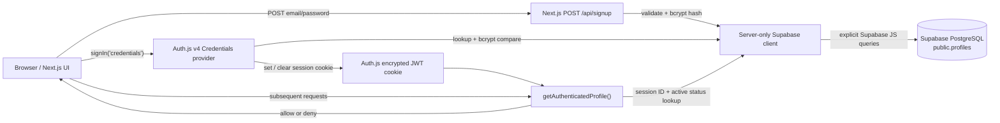
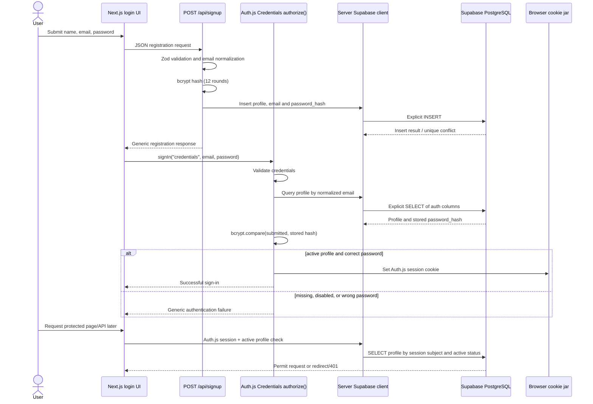

# Authentication Architecture and Implementation

## Project findings and scope

This guide describes the current email-and-password pipeline in this project. It uses Auth.js through the installed `next-auth` v4 API and stores application credentials in the existing Supabase PostgreSQL `public.profiles` table. It does **not** use Supabase Auth.

| Component | Installed project version / finding |
| --- | --- |
| Next.js | `16.4.2` (App Router) |
| Auth.js package | `next-auth@4.24.15` |
| Supabase client | `@supabase/supabase-js@^2.118.0` |
| Password hashing | `bcryptjs@^3.0.3` |
| Validation | `zod@^4.6.7` |
| Existing UI | `/login`, `/find`, `/chat`, and `/profile` App Router pages |

The supplied live table definition uses a `bigint` identity primary key and profile fields. The checked-in [`schema.sql`](./schema.sql), however, describes a different `profiles` table with a UUID primary key. This implementation and the migration below target the **live schema supplied in the request**. Confirm the actual Supabase schema before applying the migration; do not run the old `schema.sql` against the existing table as a replacement.

### Implemented versus not yet implemented

| Capability | Status |
| --- | --- |
| Register email/password into `public.profiles` | Implemented in `POST /api/signup` |
| Normalize email, validate with Zod, hash with bcrypt | Implemented |
| Auth.js Credentials login and JWT sessions | Implemented |
| Keep the password hash out of the returned user and session | Implemented |
| Check account status on protected pages and current app APIs | Implemented |
| Restrict the Supabase table to server-side access | Migration enables RLS and revokes `anon`/`authenticated` table privileges |
| Email verification and email delivery | Not implemented; `email_verified_at` is only a schema field |
| Forgot-password/reset flow | Not implemented |
| Durable login/signup rate limiting | Not implemented; required before public production launch |
| MFA, roles, audit-event storage | Not implemented |
| User-owned, persistent match/decision data | Not implemented; current match data remains in-memory demo data |

The current signup flow allows an account to sign in immediately; it does not prove control of the email address. Do not present an account as verified or deploy open registration publicly until email verification, abuse limits, and operational recovery procedures are added.

## High-level architecture

### Component diagram



Supabase does not intercept or automatically handle NextAuth requests. Next.js application code explicitly calls `@supabase/supabase-js` from the server for registration, credential lookup, and active-account checks. Supabase is used here as a PostgreSQL provider, not as the authentication/session provider.

### Registration and login sequence



## Architectural decisions

### Auth.js Credentials and JWT sessions

Credentials are handled by the project's installed Auth.js v4 `CredentialsProvider`. The project does not configure a NextAuth database adapter. Auth.js Credentials requires JWT sessions, so the implementation explicitly uses `session.strategy: "jwt"` with a 12-hour maximum lifetime. Auth.js v4 encrypts its JWT by default; keep that default.

JWTs are efficient and avoid a session row for every login, but a JWT is not instantly revocable by itself. This project therefore validates the current `profiles.account_status` in `getAuthenticatedProfile()` for protected pages and API routes. Set a profile to `disabled` to deny protected requests on the next server-side check. The browser cookie can remain present until it expires or the user signs out. Any new protected server action or endpoint must call the same helper rather than trusting the client UI.

If centralized per-device session deletion, session inventory, or immediate logout from all devices becomes a requirement, add a database-session store/adapter or a revocation/version check and evaluate its adapter support for Credentials. Do not assume a JWT logout invalidates a copied token.

### Password hashing

Argon2id is a strong first choice for a new password store where a maintained implementation is available and compatible with the deployment runtime. This repository already has `bcryptjs` installed and no Argon2 package. The implementation uses bcrypt with 12 salt rounds rather than introducing an unrequested native dependency. Benchmark the work factor on production hardware and raise it if login latency permits.

bcrypt processes at most 72 UTF-8 bytes. The shared Zod schema rejects passwords beyond that byte limit to prevent different long passwords being treated as the same bcrypt input. Passwords are never trimmed, stored in plaintext, included in responses, or copied into the Auth.js session.

### Supabase and RLS

`getSupabaseAdmin()` is server-only and uses `SUPABASE_SERVICE_ROLE_KEY`. A Supabase service-role client bypasses Row Level Security. RLS is still enabled as defense in depth, and the migration revokes table privileges from `anon` and `authenticated`, but **neither RLS nor those grants authorize operations performed using the service-role key**. The application must authenticate and authorize every such operation in server code.

Only select the columns needed for a specific operation. The login query reads the hash for verification, while the session query never selects it. Never send service-role credentials to a browser, and never rely on an RLS policy to protect requests that use this privileged client.

## Data model and migration

The supplied `profiles` table already has:

- `id bigint generated by default as identity` primary key
- `created_at timestamptz`
- `tag`, `name`, `bio`, `last_seen`, and `profile_pic`

The migration adds only authentication/account fields:

| Added field/index | Purpose |
| --- | --- |
| `email` | Normalized sign-in identifier; nullable temporarily for pre-existing profiles |
| `password_hash` | bcrypt hash; nullable for legacy/profile-only rows |
| `email_verified_at` | Reserved for the future email verification flow; null means not verified |
| `account_status` | `active` or `disabled`; checked for login and protected requests |
| `updated_at` | Timestamp for later profile/account updates |
| `profiles_email_normalized_uidx` | Case-insensitive uniqueness via `lower(email)`; null emails are excluded |

The application lowercases and trims email before lookup/insertion. Keep the database unique index as the final race-safe duplicate check. The endpoint treats unique conflicts generically to avoid disclosing whether an address is registered.

Apply the additive migration to the existing database using your normal Supabase migration/deployment workflow:

[`supabase/migrations/20261024123000_add_password_auth_to_profiles.sql`](./supabase/migrations/20261024123000_add_password_auth_to_profiles.sql)

```sql
alter table public.profiles
  add column if not exists email text,
  add column if not exists password_hash text,
  add column if not exists email_verified_at timestamptz,
  add column if not exists account_status text not null default 'active',
  add column if not exists updated_at timestamptz not null default now();

create unique index if not exists profiles_email_normalized_uidx
  on public.profiles (lower(email))
  where email is not null;

do $migration$
begin
  if not exists (
    select 1
    from pg_constraint
    where conname = 'profiles_account_status_check'
      and conrelid = 'public.profiles'::regclass
  ) then
    alter table public.profiles
      add constraint profiles_account_status_check
      check (account_status in ('active', 'disabled'));
  end if;

  if not exists (
    select 1
    from pg_constraint
    where conname = 'profiles_email_normalized_check'
      and conrelid = 'public.profiles'::regclass
  ) then
    alter table public.profiles
      add constraint profiles_email_normalized_check
      check (email is null or email = lower(btrim(email)));
  end if;

  if not exists (
    select 1
    from pg_constraint
    where conname = 'profiles_credentials_pair_check'
      and conrelid = 'public.profiles'::regclass
  ) then
    alter table public.profiles
      add constraint profiles_credentials_pair_check
      check (
        (email is null and password_hash is null)
        or (email is not null and password_hash is not null)
      );
  end if;
end;
$migration$;

alter table public.profiles enable row level security;
revoke all on table public.profiles from anon, authenticated;
```

There are no `anon` or `authenticated` policies because this implementation accesses `profiles` only from server-side application code. Revoking those grants can affect any existing direct browser-to-table access; confirm that none is required before applying this migration. The application currently uses demo profile data for matching, so that data is not made private or persistent by this authentication change.

The app's current table uses a `bigint` ID. Auth.js expects a string user ID, so the Credentials provider converts the returned ID to a string. Keep ownership comparisons server-side; if IDs could exceed JavaScript's safe integer range in your deployment, consider an opaque UUID user identifier or a database view/RPC that returns the ID as text.

## Environment configuration

Add these values to the local environment file and deployment secret manager. The following is an example only; it contains no real credentials:

```dotenv
# Public project URL; this URL is not a credential.
NEXT_PUBLIC_SUPABASE_URL=https://your-project.supabase.co

# Server-only secret/service-role key. Never use the NEXT_PUBLIC_ prefix.
SUPABASE_SERVICE_ROLE_KEY=replace-with-a-server-only-secret

# Random, high-entropy Auth.js signing/encryption secret.
AUTH_SECRET=replace-with-a-long-random-secret

# Optional for deployments where Auth.js v4 needs an explicit canonical URL.
# NEXTAUTH_URL=https://your-production-domain.example
```

| Variable | Browser-visible? | Use |
| --- | --- | --- |
| `NEXT_PUBLIC_SUPABASE_URL` | Yes | Supabase project URL, not a secret |
| `SUPABASE_SERVICE_ROLE_KEY` | **No** | Server-side database client with elevated privileges |
| `AUTH_SECRET` | **No** | Auth.js token/cookie cryptographic secret |
| `NEXTAUTH_URL` | No | Optional canonical URL for the installed Auth.js v4 deployment |

A Supabase publishable/anon key can be exposed if browser-side Supabase features require it, provided database grants and RLS are correct. The authentication code does not need it. Never put a service-role/secret key behind `NEXT_PUBLIC_`, in source control, in a client component, or in API responses. Rotate keys if they have ever been exposed.

## Implemented request flow

### Registration

The login UI sends a JSON request to `POST /api/signup`:

```http
POST /api/signup
Content-Type: application/json

{
  "name": "Example User",
  "email": "person@example.com",
  "password": "a-long-user-chosen-password"
}
```

The server validates the body using `registrationSchema`, normalizes email with trim/lowercase, computes a bcrypt hash, and inserts only the hash into `public.profiles`. The response does not include a profile ID or hash:

```http
HTTP/1.1 200 OK
Content-Type: application/json

{
  "message": "If the account can be created, you can now try signing in."
}
```

The duplicate-email path returns the same response body. The UI then attempts the ordinary login flow, whose failure message is also generic. Invalid input returns `400`; temporary database failures return `503` with a generic message. Detailed database error text and request bodies are not returned to clients.

### Login

The UI calls Auth.js `signIn("credentials", { email, password })`. Auth.js calls `authorize()`, which repeats server-side validation, looks up the profile by normalized email, rejects missing/disabled/passwordless rows, and compares the supplied password against `password_hash`. On success it returns only `id`, `email`, and `name` to Auth.js. On failure it returns no user, so the client receives a generic credential failure.

Supabase does not receive the login request automatically. The explicit `.from("profiles").select(...).eq(...).maybeSingle()` call in `src/lib/auth.ts` is what queries PostgreSQL.

### Logout and protected resources

The existing UI uses Auth.js `signOut()`. For server code, use `getAuthenticatedProfile()` from `src/lib/auth/session.ts`; it validates the Auth.js session and checks that the current database profile still exists and is `active`.

```ts
import { NextResponse } from "next/server";
import { getAuthenticatedProfile } from "@/lib/auth/session";

export async function GET() {
  const profile = await getAuthenticatedProfile();

  if (!profile) {
    return NextResponse.json(
      { error: "Authentication required." },
      { status: 401 },
    );
  }

  // Use profile.id as the authenticated owner. Do not accept an owner ID
  // from the request body or query string.
  return NextResponse.json({ id: profile.id });
}
```

The same check is used on `/find`, `/chat`, `/profile`, `/api/profiles`, `/api/matches`, and `/api/descision`. For new server actions, call the helper at the beginning of each action. For data with ownership, include the authenticated ID in the database predicate, for example `eq("owner_id", profile.id)`, and verify the requested record belongs to that owner. Authentication alone does not establish resource ownership.

## Authentication versus authorization

- **Authentication** establishes that credentials match a profile and produces an Auth.js session.
- **Authorization** checks whether the authenticated profile can perform a particular operation.

This project currently has no role column or role-based policy, and it does not grant administrative roles. Do not add role claims from client-supplied values. If roles are needed, add a controlled database role model, load the role from a trusted server-side query, and enforce it for each sensitive operation. For user-owned records, derive ownership from `getAuthenticatedProfile().id`, never a posted `userId`.

## Error handling and security behavior

- Invalid input is rejected server-side even when the browser form has HTML constraints.
- Login failures intentionally do not distinguish wrong password, missing account, inactive account, or passwordless legacy profile. Missing/inactive/passwordless accounts also perform a dummy bcrypt comparison to reduce timing-based account enumeration.
- Duplicate registration does not reveal whether the email exists.
- Database error details are logged only as a database error code/name and are not returned to the client. Never log raw request bodies, passwords, password hashes, session cookies, or secret keys.
- `getAuthenticatedProfile()` throws on database lookup errors instead of treating a database outage as an unauthenticated success. Route-level error monitoring should report that failure without recording credentials.
- The privileged Supabase client bypasses RLS, so every privileged query must be scoped and authorized in application code.
- Password hashes are only fetched in the Credentials authorization lookup and are excluded from Auth.js user/session payloads and API responses.

## Threat model and security checklist

| Threat | Current mitigation / required action |
| --- | --- |
| Plaintext or weak password storage | bcrypt hash with 12 rounds; never store or log plaintext. Consider Argon2id when a suitable runtime dependency is adopted. Benchmark bcrypt work factor. |
| bcrypt long-password ambiguity | Reject passwords over 72 UTF-8 bytes in the shared server schema. |
| Credential stuffing / brute force | **Not implemented.** Add durable per-IP and per-account throttling, monitoring, and optionally MFA before public launch. Do not rely on an in-memory limiter across serverless instances. |
| Account enumeration | Login errors are generic; duplicate signup has the same response as a successful insert. Keep timing and response details generic as well. |
| CSRF | Auth.js manages CSRF protections for its own authentication endpoints. Signup is a public JSON endpoint without authenticated cookie authority; restrict allowed origins at the edge/application boundary and rate-limit signup. Reassess CSRF if it later uses cookies or mutates authenticated state. |
| Session fixation | Use Auth.js sign-in/sign-out handlers and cookies; do not accept a caller-supplied session ID or construct custom session cookies. |
| Cookie theft / XSS | Auth.js cookies are HttpOnly and SameSite=Lax by default, and this app sets secure cookies in production. Enforce HTTPS, a restrictive CSP, and avoid unsafe HTML injection. |
| JWT revocation | JWTs are not immediately revocable by themselves. This project checks the profile's active status on protected server operations and uses a 12-hour maximum lifetime. Any new protected operation must use the helper. |
| Reset / verification token abuse | **Not implemented.** Future tokens must be random, short-lived, single-use, stored as hashes, rate-limited, and invalidated after use. Do not build custom cryptography. |
| Privileged Supabase key exposure | `SUPABASE_SERVICE_ROLE_KEY` is read only by `server-only` code and must remain a deployment secret. Never use a `NEXT_PUBLIC_` name for it. |
| RLS bypass | Service-role access bypasses RLS. RLS is defense in depth only; server code must check session, active account, and ownership before every privileged operation. |
| IDOR / authorization failures | Use the ID from the validated server session and scope each record query by that owner. Never trust a client-supplied owner ID. |
| Sensitive logging | Do not log passwords, hashes, tokens, full auth payloads, or service secrets. Use minimal safe error codes and scrub telemetry. |
| Database errors | Return generic client errors; log minimal safe diagnostics; fail closed on protected operations when the account lookup cannot be completed. |
| Production secrets | Store secrets in the hosting provider's encrypted secret manager. Use distinct development/staging/production secrets and rotate exposed credentials. |
| Legacy or unverified account | Migration leaves `email_verified_at` null and existing passwords nullable. Verification is not enforced yet; add and test a verification flow before claiming addresses are verified. |
| Existing profile/match data | Current match endpoints still use shared in-memory demo state. They are not a multi-user authorization/data-isolation implementation; persist and scope that data before production use. |

### Cookie and session defaults

Auth.js v4 manages the session cookie, rather than application code manually setting a cookie. Defaults include HttpOnly and SameSite behavior; `useSecureCookies` is enabled in production in this project. Serve production only over HTTPS. Do not expose the JWT to JavaScript or copy it into local storage. `signOut()` clears the browser's cookie but cannot erase a previously copied, still-valid JWT.

## Account verification, recovery, deletion, and revocation roadmap

These flows are intentionally not represented as implemented. Add them before treating the service as production-ready:

1. **Email verification:** create a dedicated verification-token table with a unique token hash, profile ID, expiration, and consumed timestamp. Generate tokens using a vetted system random source, email only the raw token, persist only its hash, consume it transactionally once, then set `email_verified_at`. Require verified status in `authorize()` only after delivery and the end-to-end flow are operational.
2. **Forgot password:** always return the same status/message whether an email exists. Rate-limit requests. Generate a short-lived single-use reset token, store only a hash, email a link from a verified sender, and never place the password or hash in a URL.
3. **Reset password:** validate the token and new password server-side, atomically mark the token consumed and update the bcrypt hash, then revoke existing sessions (for example by maintaining a per-account token version or using database sessions). Do not reveal whether a token/account exists.
4. **Account deletion:** require a recent authenticated session and explicit confirmation, delete or anonymize user data according to retention requirements, and revoke sessions/tokens. Ensure cascading deletion behavior is deliberate.
5. **Account suspension:** set `account_status = 'disabled'`. Protected routes using `getAuthenticatedProfile()` then deny requests on the next server-side check; sign-out clears the local cookie.
6. **Rate limiting:** before exposing signup/login, use a shared durable limiter (managed Redis or a carefully designed atomic database function) with separate per-IP and per-account limits, an expiry window, monitoring, and a recovery path that avoids locking out legitimate users indefinitely.

Do not store plaintext reset/verification tokens. Use a mature email-delivery provider and validate redirect destinations to prevent open redirects.

## Implementation structure

The implemented files are:

```text
src/
  app/
    api/
      auth/[...nextauth]/route.ts   # Auth.js v4 route handler
      signup/route.ts               # registration API
      profiles/route.ts             # protected demo endpoint
      matches/route.ts              # protected demo endpoint
      descision/route.ts            # protected demo endpoint (existing spelling)
    chat/page.tsx                   # protected page
    find/page.tsx                   # protected page
    login/page.tsx                  # login/register UI
    profile/page.tsx                # protected page
  components/
    Providers.tsx                   # existing SessionProvider
    login-btn.jsx                   # email/password UI
  lib/
    auth.ts                          # NextAuthOptions and Credentials authorize()
    auth/
      session.ts                    # server-side authenticated profile guard
      validation.ts                 # Zod input schemas
    supabase-admin.ts               # lazy server-only privileged client
  types/
    next-auth.d.ts                  # Session user ID type
supabase/
  migrations/
    20261024123000_add_password_auth_to_profiles.sql
```

This follows the existing App Router layout and installed NextAuth v4 APIs. OAuth buttons/providers were removed from the login path so every offered login is backed by a row in the app's `profiles` table; OAuth-to-profile linking can be added later as a separate, explicit design.

## Testing strategy

Use an isolated Supabase development/staging project and synthetic accounts. Do not use production credentials or real users for automated tests. Seed unique test email addresses, clean them up after each run, and ensure test failures cannot trigger real email delivery.

### Unit tests

Add tests for:

- Email trim/lowercase normalization and invalid email rejection.
- Password minimum, character maximum, and UTF-8 byte maximum.
- Registration name validation.
- Generic credential failure for missing, disabled, passwordless, and wrong-password cases.
- Returned Auth.js user/session shape contains no `password_hash`.
- A profile with `account_status = disabled` is rejected by the guard.

Mock the Supabase client and bcrypt at the unit boundary; do not mock the schema under test.

### Integration tests

Against a disposable PostgreSQL/Supabase project, test:

- New registration stores a bcrypt hash, normalized email, `active` status, and no plaintext password.
- Duplicate registration produces the same public response as an eligible registration and does not overwrite the existing hash.
- Invalid JSON/input returns `400` and performs no insert.
- Duplicate normalized emails with case/whitespace differences hit the unique index.
- Successful and incorrect password verification; missing users; disabled users.
- Database/network errors return a safe error and do not leak credentials or database messages.
- RLS and grants reject `anon`/`authenticated` table operations; the server role behavior is tested separately.
- `getAuthenticatedProfile()` rejects missing/expired sessions, missing profiles, and disabled profiles, and fails closed on database errors.

### End-to-end tests

Use Playwright or the project's chosen browser runner to cover:

- Registration, subsequent login, and logout.
- Duplicate email, invalid input, wrong password, and missing user feedback.
- Unauthenticated navigation to `/find`, `/chat`, `/profile` redirects to `/login`.
- Unauthenticated API calls receive `401`.
- Disabled account is denied on its next protected request.
- Two test users cannot access each other's records once user-owned persistence is introduced.
- Session expiration and sign-out behavior.
- Rate-limit behavior after a durable rate limiter is implemented.
- Reset/verification expired and invalid token behavior after those flows exist.

The current repository does not define an authentication-specific test suite. Add tests alongside the implementation before launch; lint/build checks alone do not prove auth behavior.

## Deployment checklist

- [ ] Verify the live `public.profiles` shape matches the supplied bigint-identity definition.
- [ ] Review the privilege revocation in the migration against any existing direct Supabase table access.
- [ ] Apply the migration and confirm the unique normalized-email index and RLS state.
- [ ] Configure `NEXT_PUBLIC_SUPABASE_URL`, `SUPABASE_SERVICE_ROLE_KEY`, and a unique high-entropy `AUTH_SECRET` in the deployment secret manager.
- [ ] Confirm the service-role key is absent from client bundles, logs, source control, and all `NEXT_PUBLIC_` variables.
- [ ] Use HTTPS; verify the production Auth.js cookie is Secure, HttpOnly, and SameSite=Lax.
- [ ] Configure the canonical URL as required by the deployment and Auth.js v4.
- [ ] Add and test durable login/signup rate limiting and abuse alerting.
- [ ] Implement email verification and password recovery with tested single-use token handling.
- [ ] Test account disablement, session expiration, and safe database outage behavior.
- [ ] Review every new API route/server action for session validation and resource ownership predicates.
- [ ] Replace shared in-memory demo match/decision state with persistent per-user data before production.
- [ ] Keep production, staging, and local secrets/data isolated; prepare secret rotation and backup procedures.

## Troubleshooting

| Symptom | Checks |
| --- | --- |
| Signup/login returns service unavailable | Confirm URL and server-only service-role key are configured on the server; check safe server logs for Supabase error code. Verify migration and database grants. |
| `profiles` column not found | Apply the migration to the same project/database referenced by `NEXT_PUBLIC_SUPABASE_URL`. |
| Duplicate email behavior differs by case | Ensure email normalization is active and `profiles_email_normalized_uidx` exists. Check for pre-existing duplicate emails before creating the index. |
| Every login fails | Check row has normalized email, a valid bcrypt hash, and `account_status = 'active'`. Ensure request password meets the same policy and is not over 72 UTF-8 bytes. |
| Auth.js secret/configuration error | Set a stable high-entropy `AUTH_SECRET` in the runtime environment; do not generate a new one on each deployment. |
| Protected pages redirect after login | Inspect `/api/auth/session`, verify the session cookie is accepted for the current origin, and confirm `getAuthenticatedProfile()` can read an active profile using the server key. |
| Profile is authenticated but a protected API returns `401` | Check the profile is still active and the session subject is the profile ID. Do not "fix" this by trusting a client-provided user ID. |
| Cookie missing in production | Confirm HTTPS, production host/canonical URL, proxy forwarding, and Secure cookie behavior. Do not disable Secure cookies to work around an HTTP production deployment. |
| Direct browser Supabase profile access fails | This is intentional after the migration revokes direct role privileges. Access profile data through an authenticated, ownership-checked server route instead. |
| Session still appears in browser after account disable | The cookie may remain until expiration/sign-out, but protected server operations must reject it through `getAuthenticatedProfile()`. Keep every sensitive operation behind that guard. |

## Official references

- [Next.js App Router authentication guide](https://nextjs.org/docs/app/guides/authentication)
- [Next.js Route Handlers](https://nextjs.org/docs/app/api-reference/file-conventions/route)
- [Next.js environment variables](https://nextjs.org/docs/app/guides/environment-variables)
- [Auth.js / NextAuth v4 Credentials provider](https://next-auth.js.org/providers/credentials)
- [NextAuth v4 session options](https://next-auth.js.org/configuration/options#session)
- [NextAuth v4 callbacks](https://next-auth.js.org/configuration/callbacks)
- [Supabase JavaScript client](https://supabase.com/docs/reference/javascript/introduction)
- [Supabase service-role key and secret-key guidance](https://supabase.com/docs/guides/api/api-keys)
- [Supabase Row Level Security](https://supabase.com/docs/guides/database/postgres/row-level-security)
- [PostgreSQL constraints](https://www.postgresql.org/docs/current/ddl-constraints.html)
- [PostgreSQL indexes](https://www.postgresql.org/docs/current/indexes.html)
- [Zod documentation](https://zod.dev/)
- [bcryptjs documentation](https://github.com/dcodeIO/bcrypt.js)
- [OWASP Password Storage Cheat Sheet](https://cheatsheetseries.owasp.org/cheatsheets/Password_Storage_Cheat_Sheet.html)
